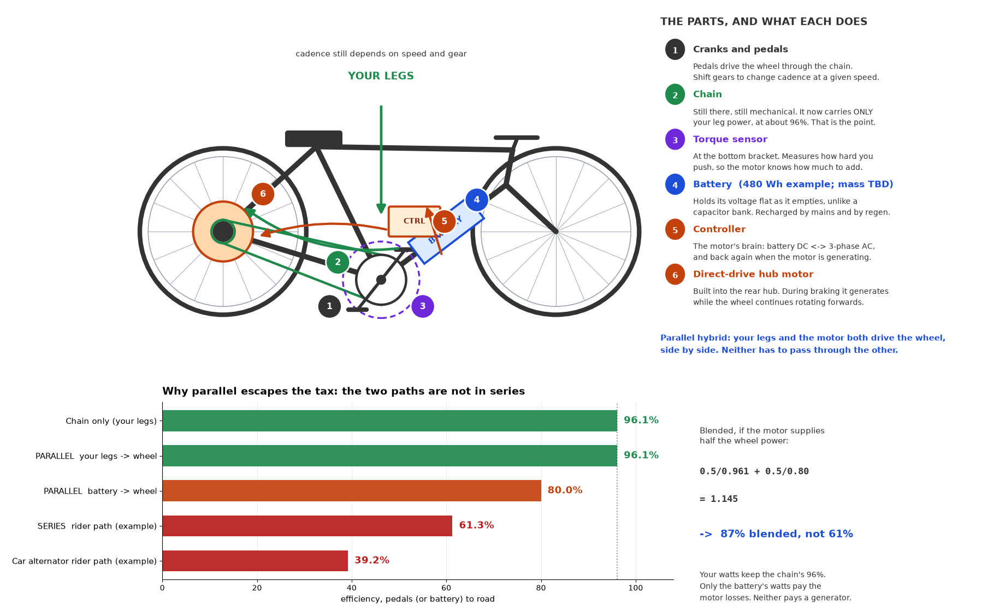
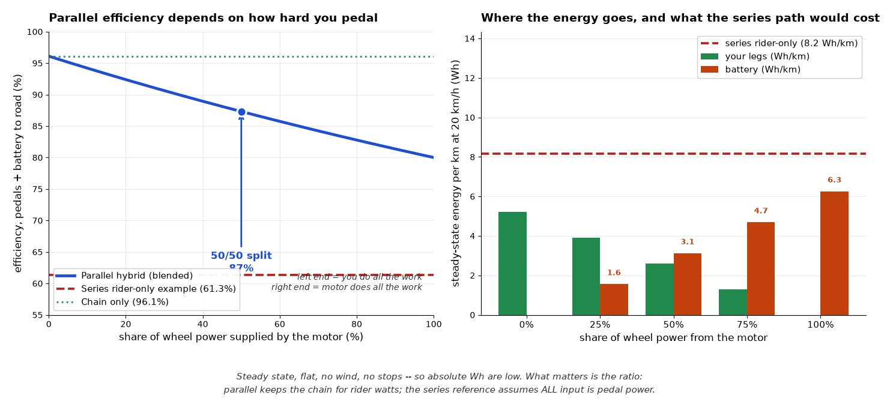

# cycle-without-chain

Historical trade study of a chainless / series-hybrid bicycle drivetrain,
now investigating an **independent-cadence series hybrid**, with a chain-retained
parallel hybrid as the comparison baseline, not the selected final architecture.

> **Supersession / purchasing caution:** the [current implementation plan](docs/PLAN-parallel-hybrid.md)
> supersedes historical build recommendations. The older analysis, model and
> diagrams are **not validated purchasing evidence**: they mix assumptions and
> unsupported product claims and contain known energy-accounting errors. See the
> plan's correction register before reusing any numerical result. No hardware has
> been purchased or definitively selected; no prototype performance is established.

The plan evaluates a PM pedal generator, active rectifier, shared DC bus, hub
inverter/motor and battery/BMS storage branch for independent cadence. Mechanical
friction brakes remain mandatory. The parallel baseline still uses gears to set
cadence and cannot provide stationary pedal charging. Next: audit old claims,
resolve CIXI vendor/version discrepancies and define requirements before sourcing
parts or testing. An illustrative 80% cruise target is not measured performance.

## Historical illustrations — not validated build specifications

[Parts, efficiency, limitations and existing bicycles](docs/analysis/parallel-hybrid-guide.md)





**Correction:** a retained chain still couples cadence to road speed through the
selected gear. Motor assistance does not replace shifting or provide pedal-by-wire.

## Current evaluation plan

[Evaluate independent pedalling / pedal-by-wire](docs/pedal-by-wire-evaluation-plan.md):
requirements, evidence audit, generator selection, fair storage comparisons,
duty-cycle modelling, bench tests and decision criteria. The chain-and-hub design
is a comparison baseline, not a substitute for independent cadence.

## Consolidated component research

[Research index, candidate BOM and evidence limits](docs/research/README.md).
Includes controller design-envelope research, machine candidates, source evidence
and the efficiency-allocation model. Earlier separate-repository work is preserved
under `archive/` as historical material, not validated design specifications.

## Question

Would a bicycle that generates electricity at the pedals (using a car or
motorbike alternator) and drives the wheels with hub motors — buffering energy
in supercapacitors — beat a chain? Should the buffer be supercapacitors,
batteries, or both? And how does a battery-less version bootstrap its
generator?

## Current direction

Try the original independent-cadence series concept through staged feasibility
checks; compare it with a chain-retained baseline against measured requirements. The historical series-efficiency scenarios are not measured
ceilings, and old battery, drag, range and price figures are not purchase criteria.

## What is in here

- `docs/analysis/chainless-drivetrain.md` — the full study: assumptions,
  cited efficiencies, buffer sizing, the battery-less bootstrap question,
  failure modes, sensitivity analysis, and a BOM.
- `docs/analysis/chainless_drivetrain_model.py` — historical stdlib-only model;
  retained unchanged for audit, including known accounting errors.
- [Series-feasibility plan (parallel baseline)](docs/PLAN-parallel-hybrid.md) — current scope, correction
  register, staged gates and measurement protocol.

**Evidence correction for §11:** no verified crank-generator efficiency map
was found for Mando Footloose or Schaeffler Free Drive. Earlier claims that both
use automotive claw-pole alternators and deliver ~32% pedals-to-road are not
established. Do not use them as measured product specifications. See the
[illustrated guide](docs/analysis/parallel-hybrid-guide.md) for source boundaries.

## Sections of the study

- §0 answer first — §1 assumptions — §2 vehicle power — §3 series vs chain
- §4 cadence — §5 buffer sizing — §6 is a buffer needed — §7 bootstrap
- §8 sensitivity — §9 failure modes — §10 recommendation
- §11 the two production systems (Mando, Schaeffler) reconciled
- **§12 the recommended build, worked numbers, parts explained**
- **§13 has anyone built this? (Stromer, Grin builds, mid-drive comparison)**
- §14 open items — §15 scope limits

## Reproduce

```sh
python3 docs/analysis/chainless_drivetrain_model.py
```

Stdlib only, no dependencies. This is a historical-model smoke run, not scientific
validation. Successful execution does not establish that its assumptions,
calculations or the diagrams are correct.
