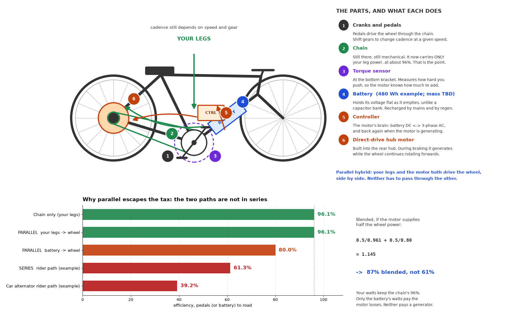
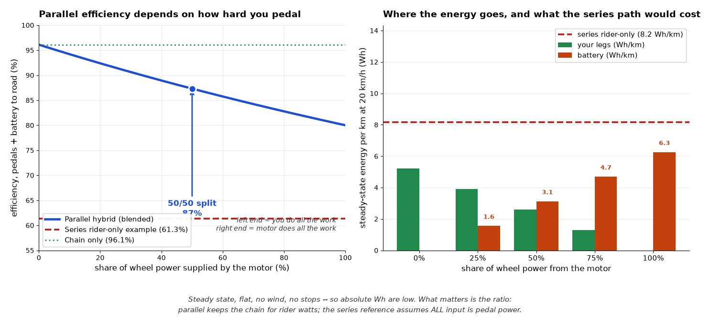

# Parallel hybrid: illustrated guide and existing bicycles

## Important correction to the earlier chat

A chain plus hub motor DOES NOT decouple cadence from wheel speed. While driving
through the chain, cadence depends on wheel speed and the selected gear. The motor
reduces the required rider torque; it does not replace gear shifting. Automatic
shifting is a separate feature. Independent cadence, including pedalling while
stationary to charge storage, requires a pedal generator or another transmission.

## Parts and power paths



- Cranks, chain and gears mechanically transmit rider power to the wheel.
- A torque sensor measures rider effort; compatible control electronics translate
  it into an assistance request. The sensor is not a generator.
- The battery supplies electrical energy. LFP and LTO are candidate chemistries,
  not selected packs. Capacity alone does not establish weight, charge acceptance,
  cold-weather limits or BMS compatibility.
- A controller such as Grin's Phaserunner controls motor phase currents. Regen
  requires appropriate configuration and battery voltage/current limits.
- A direct-drive hub such as a compatible Grin All-Axle variant adds wheel torque.
  During regen the wheel STILL rotates forwards; electromagnetic torque opposes
  rotation and energy flows back through the controller to the battery.

Keep mechanical brakes. Regen can be unavailable with a full/cold battery or an
 electrical fault. A motor phase short can also cause strong drag: a dead electrical
system is not guaranteed to be frictionless to pedal.

## Efficiency: assumptions, not product guarantees

The figures use 96.1% chain efficiency and 80% battery-terminal-to-wheel efficiency
as illustrative operating-point assumptions. Motor efficiency varies with speed,
torque, temperature and controller setup; especially slow climbing can be worse.
These figures exclude charger losses and human metabolic losses. The serial-drive
61.3% and car-alternator 39.2% references are examples for the RIDER power path,
not measured values for Mando or Schaeffler, and not universal limits.

With half the wheel output from each source:

`eta = 1 / (0.5/0.961 + 0.5/0.80) = 87.3%`

For 200 W at the wheel this means 104.1 W at the cranks plus 125 W at the battery
terminals. This mixed-input efficiency is useful engineering bookkeeping, not a
comparison of food energy with electricity.



The series reference is pedal-powered only. In a battery-assisted series hybrid,
battery energy normally joins the DC bus and does NOT pass through the generator.
The right chart is a simple flat-road, no-wind, no-stop model, not a range prediction.

## Has anyone built it?

Yes. Chain/belt drive plus electric assistance is an established parallel-hybrid
architecture. The regenerative hub-motor subset has both commercial bikes and kits.

### Stromer ST series

Stromer's ST3 is a close commercial example: mechanical bicycle gearing plus a
gearless rear hub motor and adjustable regenerative braking. Many Stromers are
speed-pedelecs; check local vehicle classification before treating one as an ordinary
25 km/h pedelec.

- [ST3 review describing the direct-drive motor and regen](https://electricbikereview.com/stromer/st3)
- [Stromer ST1 technology](https://stromerbike.com/en/us/technology/st1-technology)

### Grin conversion kits

Grin sells the component route: hub motors, controllers, instrumentation and
conversion kits. Choose a specific compatible motor/controller/battery combination,
not just a list of brand names. All-Axle generations and axle variants differ.

- [All-Axle product information](https://grintech.eu/product-info/all-axle-hub-motor.html)
- [Grin kits](https://grintech.com/collections/grin-kits)
- [Grin's regen guide](https://ebikes.ca/resources/learn/regen.html)

Grin's guide reports 3–8% recovered energy on typical direct-drive rides, with much
higher values in some loaded/trike applications. This is route-dependent, not a
universal recovery percentage or a guarantee for our build.

### Zehus all-in-one hubs

Zehus integrates motor, battery, electronics and sensors in the rear hub while
retaining the bicycle's mechanical drivetrain. Its HORIZON and HALOS products
advertise automatic and manual energy recovery respectively. This is a related
architecture, not necessarily the same direct-drive motor construction.

- [Zehus All In One](https://www.zehus.it/product-categories/all-in-one)

### Copenhagen Wheel (historical)

Superpedestrian's Copenhagen Wheel integrated assistance and regenerative braking
into a replacement rear wheel. It is historical prior art, not a current purchasing
recommendation.

- [Copenhagen Wheel review](https://electricbikereview.com/superpedestrian/copenhagen-wheel)

## Regen is not restricted to direct-drive motors

Most conventional geared hubs freewheel, preventing regeneration. However, geared
hubs specifically designed without that freewheel, such as Grin's GMAC, can regen.
The requirement is a back-drivable wheel-to-motor connection and compatible
controller/storage, not an absolute ban on gears.

- [GMAC clutchless geared hub](https://electrek.co/2019/07/10/grin-tech-unveils-gmac-clutchless-geared-hub-motor/)

## Evidence warning about the older study

The older README/study assigned automotive claw-pole construction and roughly
40–45% generator efficiency to Mando and Free Drive. Those assignments are not
established by the sources inspected here and must not be used as product facts.
No verified generator efficiency map for either product was found. Likewise,
Free Drive's reported 5% range difference cannot determine generator efficiency
without a defined duty cycle and rider/battery power split.

## Reproduce the figures

Install matplotlib and numpy in a virtual environment, then run:

```
python docs/analysis/make_explainer.py
python docs/analysis/make_blend_figure.py
```

The figures are explanatory models, not certified electrical or mechanical build
instructions. Pack selection, torque-arm/axle compatibility, thermal performance,
regenerative charge limits and road legality remain design work.
